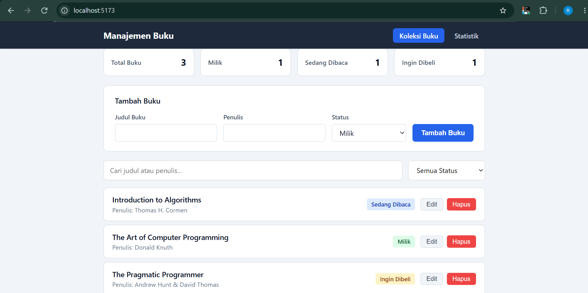
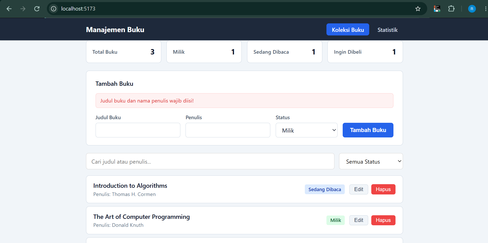
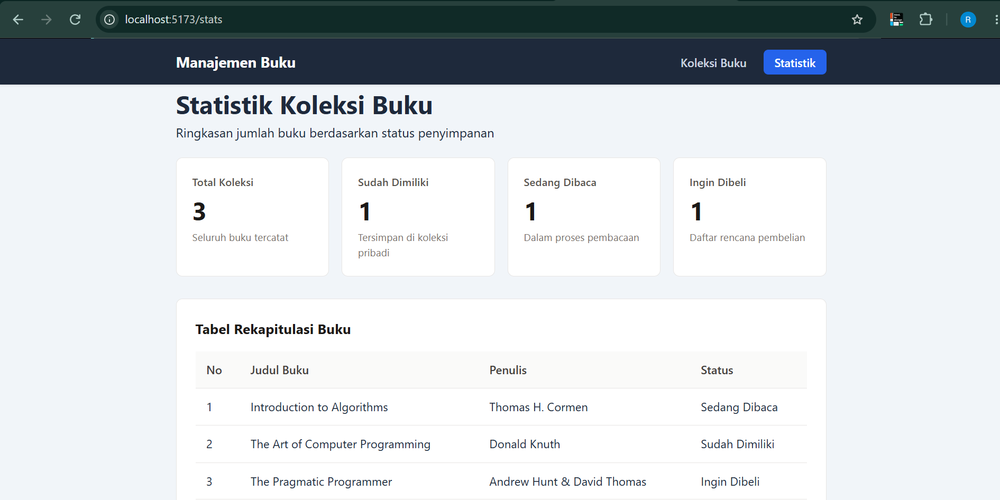
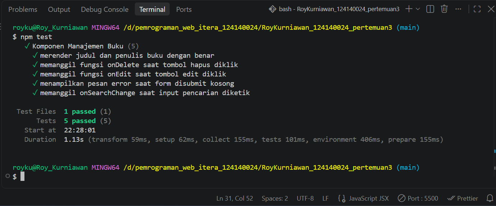

# Aplikasi Manajemen Buku Pribadi

Tugas Praktikum Pengembangan Aplikasi Web - Pertemuan 3 (React Basics)

- **Nama:** Roy Kurniawan
- **NIM:** 124140024

## Deskripsi Aplikasi
Aplikasi web berbasis React untuk mencatat koleksi buku pribadi berdasarkan status (Milik, Sedang Dibaca, dan Ingin Dibeli). Data disimpan secara lokal di browser menggunakan localStorage.

## Fitur React yang Digunakan
- **Components & Props**: Navbar, BookForm, BookFilter, dan BookList dengan validasi PropTypes.
- **State & Hooks**: useState dan useEffect untuk pengelolaan form tambah/edit, validasi error input kosong, pencarian, dan filter status.
- **Custom Hooks**: useLocalStorage dan useBookStats.
- **Context API**: BookContext untuk menyimpan state global daftar buku.
- **React Router**: Navigasi halaman Koleksi Buku (/) dan Statistik (/stats).
- **Unit Testing**: 5 unit test menggunakan Vitest dan React Testing Library pada src/components/BookList/BookList.test.jsx.

## Instruksi Instalasi dan Menjalankan Aplikasi
1. Masuk ke direktori project:
   `cd RoyKurniawan_124140024_pertemuan3`
2. Install dependensi:
   `npm install`
3. Jalankan server development:
   `npm run dev`
4. Jalankan unit testing:
   `npm test`

## Screenshot Aplikasi & Hasil Testing

## 1. Halaman Utama (Koleksi Buku)

## 2. Validasi Form Input (Error Handling)

## 3. Halaman Statistik

## 4. Hasil Unit Testing (Vitest & RTL)

