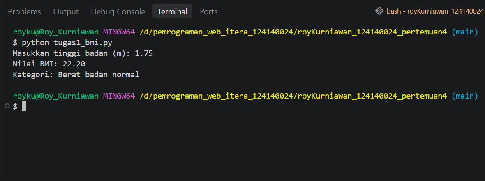
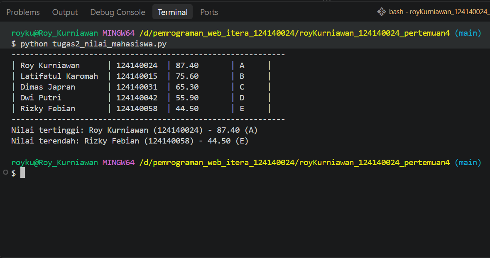
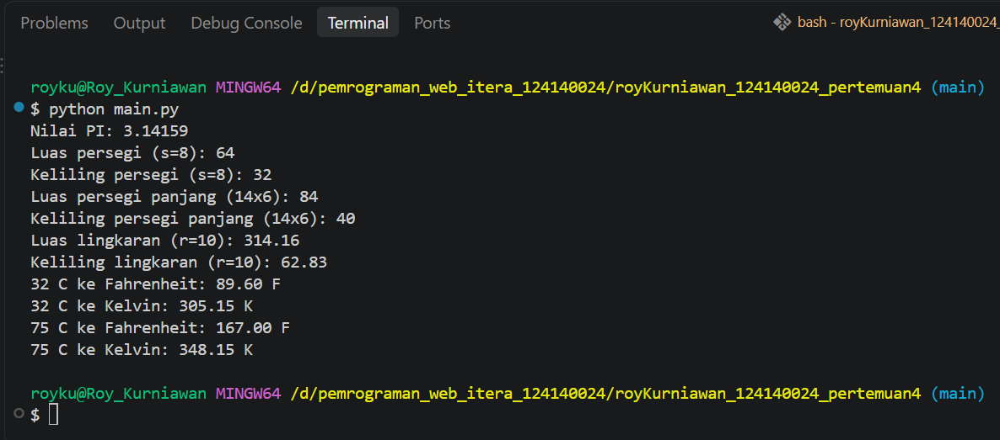

# Tugas Praktikum PAW - Pertemuan 4

Nama : Roy Kurniawan  
NIM : 124140024  

## Deskripsi Program

- **tugas1_bmi.py**: Menghitung nilai BMI dari input berat dan tinggi badan, lalu menentukan kategorinya dengan `if-elif-else`.
- **tugas2_nilai_mahasiswa.py**: Menghitung nilai akhir (30% UTS, 40% UAS, 30% Tugas) dan grade (A-E) dari 5 data mahasiswa, menampilkannya dalam tabel, serta mencari nilai tertinggi dan terendah.
- **math_operations.py**: Modul berisi konstanta `PI`, fungsi luas & keliling (persegi, persegi panjang, lingkaran), dan konversi suhu (Celsius ke Fahrenheit & Kelvin).
- **main.py**: Program utama untuk memanggil dan menguji seluruh fungsi dari modul `math_operations.py`.

## Cara Menjalankan

```bash
python tugas1_bmi.py
python tugas2_nilai_mahasiswa.py
python main.py
```

## Screenshot Hasil Eksekusi

- **Tugas 1**  


- **Tugas 2**  


- **Tugas 3**  
