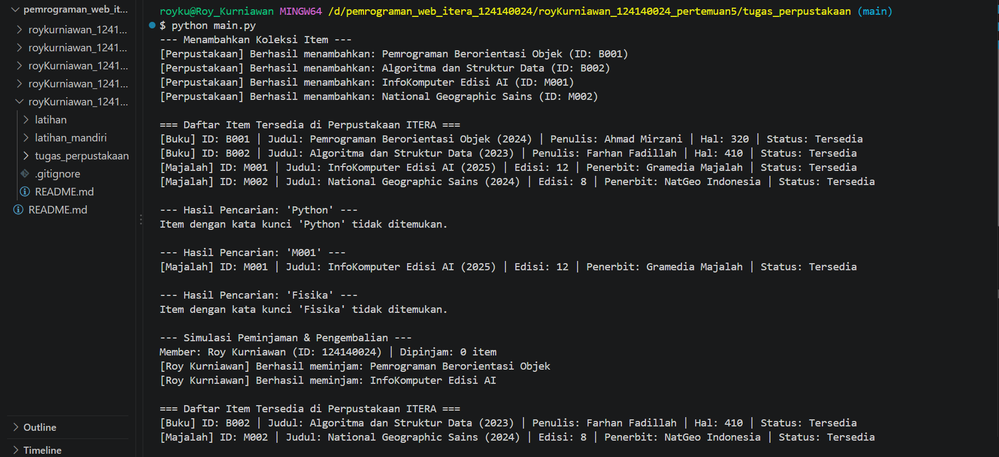
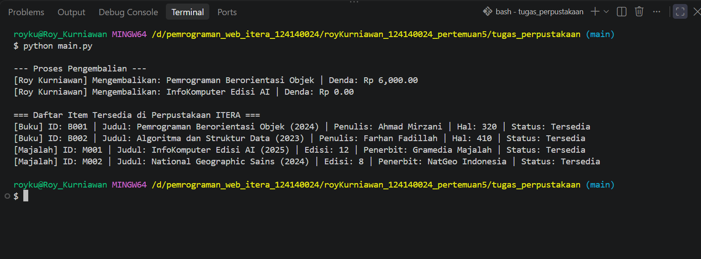

# Tugas Praktikum Pertemuan 5 - Sistem Manajemen Perpustakaan

## Identitas Mahasiswa
- **Nama Lengkap** : Roy Kurniawan
- **NIM** : 124140024
- **Kelas Praktikum** : RA

## Deskripsi Program
Program ini merupakan sistem manajemen perpustakaan sederhana berbasis Python OOP. Alur program dimulai dengan menginisialisasi objek perpustakaan (`Library`), menambahkan koleksi buku (`Book`) dan majalah (`Magazine`), menampilkan daftar item yang tersedia, mencari item berdasarkan judul atau ID, serta mensimulasikan peminjaman dan pengembalian item oleh anggota (`Member`).

Penerapan konsep OOP dalam program:
1. **Abstraction & Class**: Menggunakan abstract class `LibraryItem(ABC)` sebagai kerangka dasar item perpustakaan dengan `@abstractmethod` pada `get_detail()` dan `hitung_denda()`, serta class `Library` dan `Member` untuk mengelola koleksi dan peminjam.
2. **Inheritance**: Class `Book` dan `Magazine` mewarisi atribut dasar dari `LibraryItem` menggunakan `super().__init__()` dan menambahkan atribut spesifik masing-masing.
3. **Encapsulation**: Melindungi data menggunakan atribut protected (`_id_item`, `_judul`, `_tahun`) dan private (`__is_dipinjam`, `__koleksi`, `__daftar_pinjaman`), serta mengatur akses status peminjaman menggunakan `@property` dan `@is_dipinjam.setter`.
4. **Polymorphism**: Method `get_detail()` dan `hitung_denda()` di-override pada class `Book` dan `Magazine` sehingga menghasilkan format informasi dan perhitungan tarif denda yang berbeda sesuai jenis itemnya.

## Panduan Menjalankan Program
1. Masuk ke direktori `tugas_perpustakaan`:

       cd tugas_perpustakaan

2. Jalankan program di terminal:

       python main.py

## Screenshot Output

