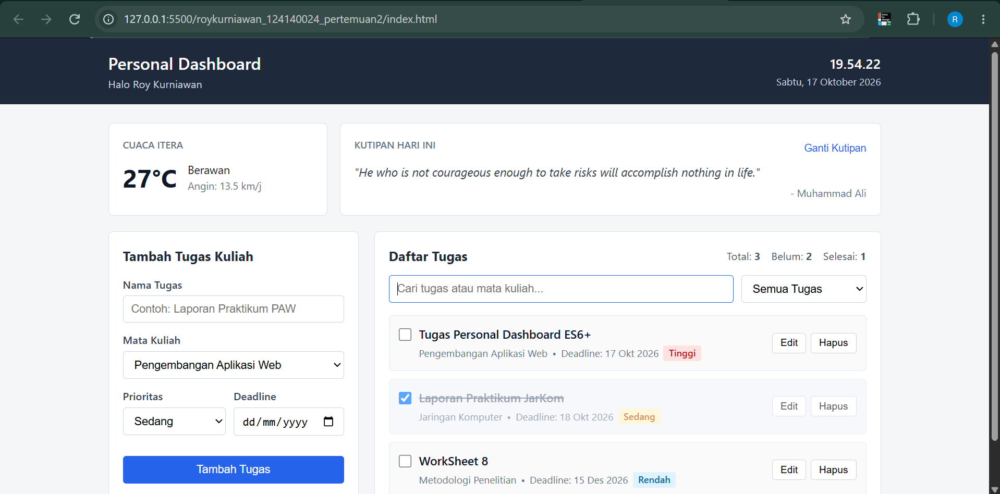

# Tugas Praktikum PAW Pertemuan 2 - Personal Dashboard

- **Nama**: Roy Kurniawan
- **NIM**: 124140024
- **Mata Kuliah**: Pengembangan Aplikasi Web - RA

## Deskripsi Aplikasi

Aplikasi **Personal Dashboard** ini dibuat untuk membantu mencatat daftar tugas kuliah beserta deadline dan prioritasnya. Selain pencatatan tugas, halaman ini juga menampilkan informasi jam aktif, cuaca terkini di area Kampus ITERA (menggunakan Open-Meteo API), serta kutipan harian (menggunakan DummyJSON API).

### Fitur Aplikasi:
1. **CRUD Tugas Kuliah**: Menambah tugas baru, mengubah isi tugas yang sudah ada, menandai tugas selesai dengan checkbox, dan menghapus tugas.
2. **Penyimpanan Lokal**: Data tugas disimpan ke `localStorage` dengan key `paw_dashboard_tasks` sehingga tidak hilang ketika browser di-refresh.
3. **Filter dan Pencarian**: Menyaring daftar tugas berdasarkan status (Semua, Belum Selesai, Sudah Selesai) dan mencari berdasarkan judul tugas atau nama mata kuliah.
4. **Data Asinkron (API Publik)**:
   - Informasi suhu, kondisi cuaca, dan kecepatan angin di Kampus ITERA (`api.open-meteo.com`).
   - Kutipan harian acak beserta tombol untuk mengganti kutipan (`dummyjson.com/quotes/random`).

## Struktur File

Struktur file disusun mengikuti panduan pada modul **Setup Project**:

```text
roykurniawan_124140024_pertemuan2/
├── index.html
├── css/
│   └── style.css
├── js/
│   ├── main.js
│   ├── app.js
│   └── modules/
│       ├── data.js
│       └── utils.js
└── README.md
```

## Implementasi Fitur ES6+

| No | Fitur ES6+ | File | Baris Kode | Keterangan |
| :-: | :--- | :--- | :--- | :--- |
| 1 | `let` dan `const` | `js/main.js`<br>`js/app.js` | Baris `3-15`<br>Baris `40-42`, `116-121`, `126-131` | Deklarasi variabel block-scoped (`const` untuk referensi tetap dan `let` untuk variabel `editingId`). |
| 2 | Arrow Functions | `js/modules/utils.js`<br>`js/main.js`<br>`js/app.js` | Baris `1-9`, `11-19`<br>Baris `17-30`, `32-37`, `39-76`<br>Baris `43`, `74`, `83`, `88`, `100`, `118` | Digunakan pada fungsi helper, fungsi pengendali DOM, event listener, dan callback array. |
| 3 | Template Literals | `js/main.js` | Baris `44`, `54-73`, `92-97` | Menyusun template kartu tugas HTML multi-baris secara dinamis dan interpolasi variabel `${...}`. |
| 4 | Classes (`TaskItem` & `DashboardApp`) | `js/app.js` | Baris `4-28` (`TaskItem`)<br>Baris `30-161` (`DashboardApp`) | `class TaskItem` memodelkan struktur data tugas dan `class DashboardApp` mengelola state, `localStorage`, serta `fetch()`. |
| 5 | Default Parameters | `js/modules/utils.js`<br>`js/app.js` | Baris `1`, `11`<br>Baris `6-11`, `31`, `61` | Nilai bawaan pada parameter fungsi dan constructor class. |
| 6 | Destructuring (Object, Array, & Parameter) | `js/app.js`<br>`js/main.js` | Baris `5-12`, `61`, `73`, `131`, `152`<br>Baris `33`, `87-90` | Destructuring pada parameter fungsi (`addTask`, `updateTask`), response JSON API, dan hasil paralel `Promise.all`. |
| 7 | Spread Operator (`...`) | `js/app.js` | Baris `68`, `76` | Menjaga data tetap *immutable* saat menambah tugas (`[newTask, ...this.tasks]`) dan mengupdate objek tugas (`{ ...task, ... }`). |
| 8 | Modern Array Methods | `js/app.js`<br>`js/main.js` | `.map()`: `app.js` (`43`, `74`), `main.js` (`49`)<br>`.filter()`: `app.js` (`83`, `100`)<br>`.find()`: `app.js` (`88`, `96`)<br>`.reduce()`: `app.js` (`117-120`) | Mengolah array data tugas untuk render tampilan, pencarian, filter status, dan kalkulasi statistik selesai. |
| 9 | Async / Await & Promises | `js/app.js`<br>`js/main.js` | Baris `125-145`, `147-160`<br>Baris `86-98`, `159-163` | Mengambil data API cuaca dan kutipan secara asinkron dengan `async/await`, `try/catch`, dan `Promise.all()`. |
| 10 | ES Modules (`import` / `export`) | `js/modules/data.js`<br>`js/modules/utils.js`<br>`js/app.js`<br>`js/main.js` | Baris `1`<br>Baris `1`, `11`<br>Baris `1-2`, `4`, `30`<br>Baris `1` | Modularisasi kode menggunakan `export` dan `import` dengan `<script type="module" src="js/main.js">`. |

## Screenshot Aplikasi

### Tampilan Utama Dashboard
